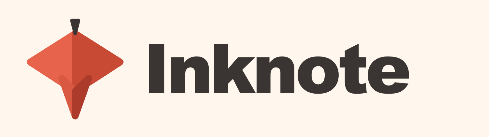

# Inknote — Origami Bird (Peach Sky)

The Origami Bird mark is a paper bird folded from one sheet, wings spread, with softly rounded folds in two shades of vermilion and a charcoal head. The app icon sets it on a peach-to-cream sky; use the horizontal logo for project documentation.



| Asset | Use |
| --- | --- |
| `inknote-mark.svg` | Standalone vermilion mark, transparent background |
| `inknote-mark-monochrome.svg` | Single-color mark; uses `currentColor` when embedded inline |
| `inknote-icon.svg` | App icon master, with a peach-to-cream rounded square and transparent outer margin |
| `inknote-icon-1024.png` | 1024 × 1024 app icon preview |
| `inknote-logo-horizontal.svg` | Editable horizontal mark and wordmark |
| `inknote-logo-horizontal.png` | Rendered horizontal logo for README and documentation |

Colors: folds `#E8634B`, `#C84A35`, `#D95842` and `#AD3B2B`, head `#3A3532`, sky `#FFD9C4` to `#FFF4EA`, page `#FFF6EE`.

## Regenerate

```sh
npm ci
npm run icons
```

Run on macOS to regenerate the complete set, including `build/icon.icns` via Apple's `iconutil`. The horizontal SVG uses Arial Black with fallbacks; use macOS with Arial Black installed to match the checked-in PNG. The PNG is the portable wordmark asset.

The script renders SVGs through the project's Electron runtime and updates:

- `assets/icon/inknote-icon-1024.png`
- `assets/icon/inknote-logo-horizontal.png`
- `resources/icon.png` for the development Dock icon, app windows and system tray
- `build/icon.png` for Windows/Linux packaging
- `build/icon.icns` for macOS packaging (16–1024 px representations)

The renderer favicon references `inknote-icon.svg` directly through Vite. Keep the standalone marks and icon/logo SVG geometry synchronized when changing the mark. Commit the SVG sources and generated files together. Do not substitute concept presentation images for production assets.

The application screenshot in `docs/screenshot.png` contains no brand icon and remains a UI illustration.
